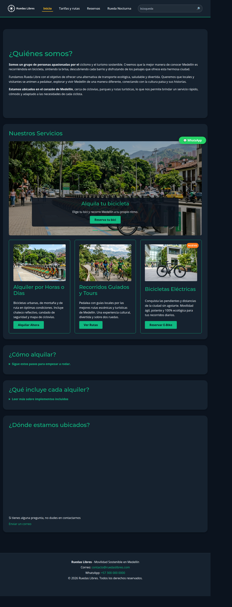
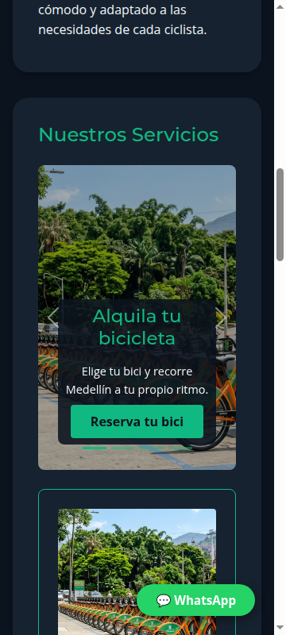
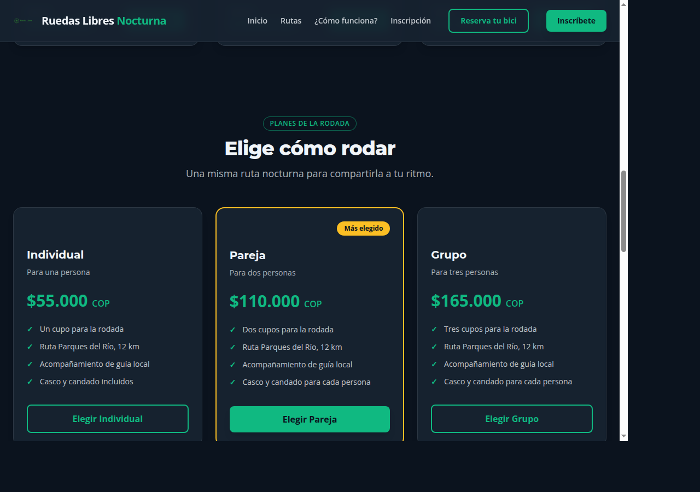

# Ruedas Libres

Sitio estático para conocer y reservar bicicletas y recorridos guiados en Medellín. El proyecto reúne el sitio principal de Rueda Libre y una experiencia dedicada a la rodada nocturna.

## Enlaces

- Repositorio: [github.com/porscheodin/RuedasLibres](https://github.com/porscheodin/RuedasLibres)
- URL prevista del sitio: [porscheodin.github.io/RuedasLibres](https://porscheodin.github.io/RuedasLibres/)
- Landing nocturna prevista: [porscheodin.github.io/RuedasLibres/nocturna](https://porscheodin.github.io/RuedasLibres/nocturna/)

**Estado de publicación:** las dos URLs de Pages devuelven 404 porque GitHub Pages aún no está habilitado para el repositorio. La sesión de trabajo no tiene acceso autenticado a Settings. Para publicar: en GitHub abre **Settings → Pages**, elige **GitHub Actions** como fuente y después ejecuta **Actions → Deploy static site to GitHub Pages → Run workflow**. El workflow manual está en `.github/workflows/pages.yml`.

## Páginas

- `index.html`: portada, servicios y carrusel de cuatro diapositivas.
- `paginas/tarifas.html`: precios de alquiler y recorridos.
- `paginas/reservas.html`: formulario validado de reserva.
- `nocturna/index.html`: rutas nocturnas, planes e inscripción.
- `nocturna/componentes.html`: catálogo de componentes y campos.

## Tecnologías

- HTML5 semántico y CSS.
- Bootstrap 5.3.8 para el sitio principal y el carrusel.
- Tailwind CSS 4.3.5 CLI para la landing nocturna; el CSS generado se minifica y comparte con el kit.
- Google Fonts: Open Sans y Montserrat.
- Validación nativa del navegador para formularios y preferencias de color del sistema para el modo oscuro nocturno.

Para regenerar el CSS de Tailwind:

```bash
cd nocturna
npm install
npm run build
```

## Capturas

**Escritorio, portada completa**



**Celular, carrusel de servicios**



**Landing nocturna, modo oscuro y planes**



## MiniReto 8: recomendación de framework

Recomendación: conservar Bootstrap en el sitio principal existente y usar Tailwind como opción preferida para páginas nuevas con identidad visual propia. Bootstrap aceleró la integración del carrusel y sus controles; Tailwind permitió expresar los seis colores de marca, las fuentes y `dark:` directamente con tokens, además de compilar las utilidades que usa el proyecto. El archivo compartido `nocturna/src/output.css` mide 36,887 bytes minificado. La medición previa de Bootstrap fue una referencia del CDN 5.3.8, no un benchmark de builds equivalentes; por eso la decisión se basa también en personalización, mantenimiento y componentes necesarios.

## Verificación y aprendizajes

- El validador Nu del W3C reporta cero mensajes para portada, tarifas, reservas y landing nocturna.
- Los enlaces y recursos internos se comprobaron en local; las páginas no presentan overflow a 360, 768 ni 1280 px.
- Los formularios de reservas e inscripción se probaron vacíos y completos; el teléfono de reservas requiere diez dígitos y comienza por 3.
- La navegación tiene nombres accesibles, imágenes con texto alternativo, encabezados jerárquicos y focos visibles. No hay atributos `style` en línea.
- La landing nocturna responde a `prefers-color-scheme`; las cards de planes conservan altura y padding coherentes en móvil y escritorio.
- Los enlaces entre la raíz y `nocturna/` usan rutas relativas para funcionar bajo un subpath de proyecto.
- Aprendizaje central: validar el documento y los estados reales en el navegador descubre problemas que una revisión del HTML por sí sola no encuentra, como formularios duplicados, tablas que desbordan y estilos de foco sobrescritos.

## Demo de tres minutos

1. **0:00–0:25, contexto.** “Rueda Libre atiende a residentes y visitantes que quieren alquilar una bicicleta y conocer Medellín con recorridos guiados seguros, también de noche.”
2. **0:25–0:55, sitio principal.** Mostrar la portada, las tarifas y el carrusel; avanzar hasta la cuarta diapositiva y abrir Rueda Nocturna.
3. **0:55–1:35, landing e inscripción.** Presentar las rutas, comparar Individual/Pareja/Grupo y mostrar cómo el CTA lleva al formulario validado.
4. **1:35–2:05, celular y tema.** Cambiar el viewport a 360 px, enseñar el apilado de cards y emular `prefers-color-scheme: dark`.
5. **2:05–2:45, decisiones técnicas.** Explicar dos decisiones: Bootstrap conserva una navegación/carrusel estándar en el sitio existente; Tailwind resuelve la paleta propia, `@theme` y dark mode de la experiencia nocturna. Añadir que la grilla usa filas fraccionarias para mantener cards de igual altura.
6. **2:45–3:00, cierre.** Resumir los enlaces de navegación, el contraste verificado y el próximo paso de activar Pages.

**Ensayo y retroalimentación:** pendiente de practicar frente a un compañero. No se registró feedback de una persona porque no hay un compañero disponible en este entorno; completar esta nota después del ensayo real.

## Autor

`pedriton` (autor de los commits del repositorio).

El diario detallado de desarrollo se conserva en `bitacora.txt`.
